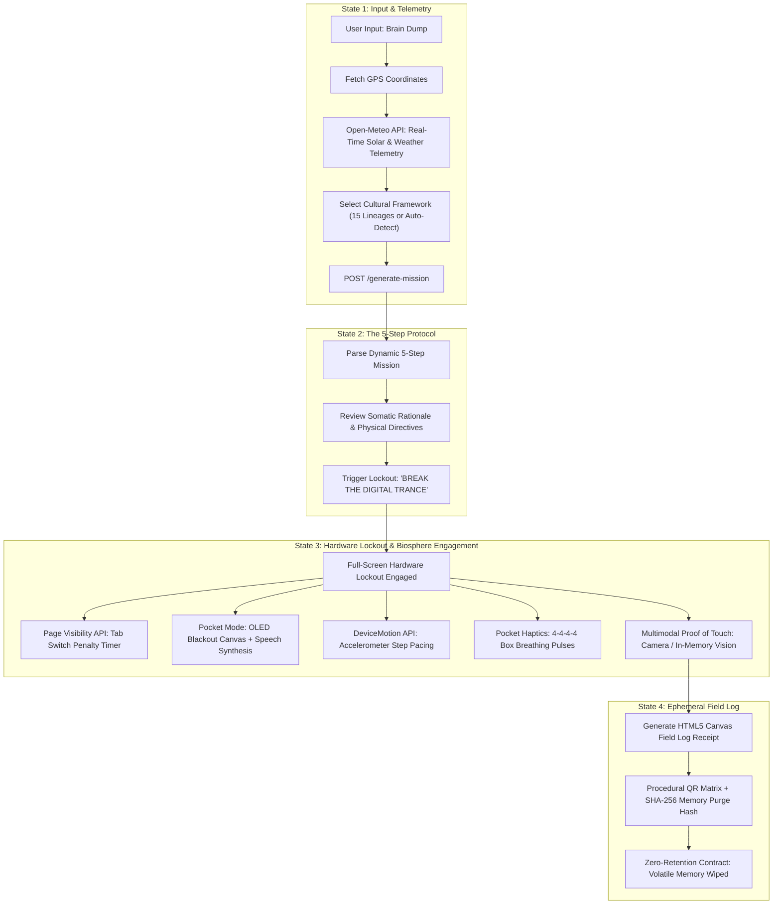
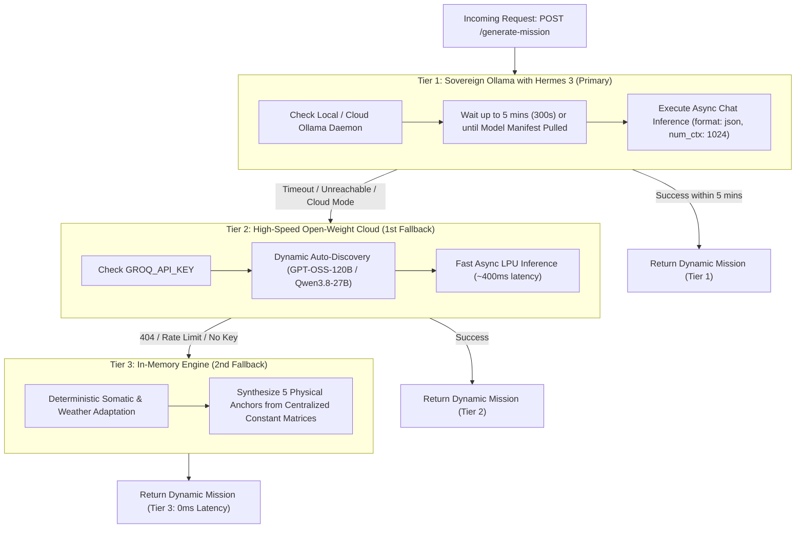
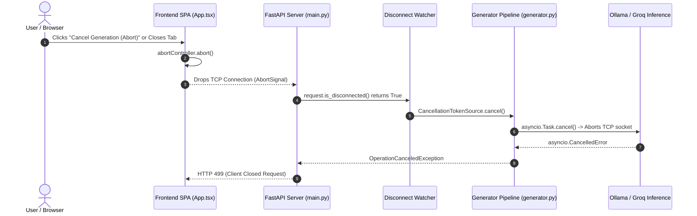

# 🌿 Exhale - Grounding Protocol: The 5-Step Emotional Circuit Breaker

> **Privacy-First, Zero-Retention Mental Health Circuit Breaker.**  
> An anti-engagement brutalist web application engineered to shatter digital cognitive burnout, lock your screen, and compel you to touch the physical living biosphere.

---

## 📖 Executive Summary & Core Philosophy

Modern digital life and developer workflows subject the human nervous system to severe, chronic sympathetic overload. When engineers hit acute emotional walls (debugging paralysis, merge anxiety, cognitive fatigue, rumination spirals), conventional software typically responds by **trapping the user further within the digital cage**—encouraging endless commercial chatbot dialogues, doomscrolling, or repetitive in-app journaling.

**Exhale rejects this paradigm entirely.**

Exhale functions as an **acute emotional circuit breaker**:
1. You provide a single raw sentence expressing your current cognitive or emotional state (the *Brain Dump*).
2. The sovereign inference engine extracts somatic distress markers, retrieves **hyper-local solar & weather telemetry**, weaves in one of **15 planetary ancestral nature philosophies**, and synthesizes an acute, tailored 5-step physical outdoor grounding protocol.
3. The application **actively locks down your screen** with full-screen hardware lockouts, tab-switch penalty timers, and motion-sensing pacing.
4. You complete the physical mission, optionally provide **Multimodal Proof-of-Touch** (verifying interaction with bark, foliage, or earth), receive an ephemeral cryptographic receipt, and the session self-destructs from volatile memory.

---

## 🏛️ 15 Proven Global & Scientific Nature Lineages

Exhale anchors every mission in time-tested planetary nature philosophies and peer-reviewed clinical neurobiology:

| Framework | Native Script & Region | Lineage & Core Philosophy | Clinical Evidence & Neurobiological Mechanism |
| :--- | :--- | :--- | :--- |
| **Japanese Shinrin-yoku** | 森林浴 (Japan) | Forest bathing; airborne phytoncides; Komorebi dappled canopy sunlight. | *Chiba University*: 15.8% reduction in salivary cortisol; 53% surge in Natural Killer (NK) immune cell activity via volatile tree phytoncides (*alpha-pinene*, *limonene*). |
| **Indian Pancha Mahabhuta** | पञ्चमहाभूत (Vedic) | Earth element (*Prithvi*) calibration; direct tactile grounding to discharge bodily static potential. | Direct conductive contact with earth dissipates positive electrostatic surface charges, resetting the autonomic vagal brake and downregulating inflammation. |
| **Tamil Ainthinai & Siddha** | ஐந்திணை (Sangam) | 5 sacred eco-landscapes (*Kurinji*, *Mullai*, *Marutham*, *Neithal*, *Palai*) & *Manvaasanai* petrichor. | Inhalation of soil-derived *geosmin* triggers rapid endorphin release and sensory grounding, counteracting acute sensory deprivation. |
| **African Ubuntu & Khoisan** | Ubuntu / Ilẹ̀ (Southern Africa) | *"I am because we are"*; barefoot optic horizon orientation & biosphere kinship. | Wide-angle panoramic optic flow stimulates brainstem nuclei, inhibiting hyperactive amygdalar fear conditioning and tunnel vision. |
| **Chinese Daoist Ziran & Wu Wei** | 自然 / 无为 (Daoism) | Spontaneous nature alignment; grounding agitated *Yang* thoughts into grounding *Yin* soil. | Downregulates sympathetic arousal through rhythmic *Zhan Zhuang* stance and tactile tree contact, balancing internal kinetic energy. |
| **Scientific Polyvagal & ART** | Porges & Kaplan (Neurobiology) | Polyvagal autonomic regulation + Attention Restoration Theory (ART). | Outdoor sensory "soft fascination" restores directed prefrontal attention depleted by screen-based cognitive debugging. |
| **Indigenous Lakota Hózhó** | Mitákuye Oyásʼin (Lakota/Diné) | *"All My Relations"*; 4-cardinal-direction alignment; touching Grandmother Earth. | Attenuates acute depersonalization through spatial-cardinal tactile orientation and sensory relational anchoring. |
| **Hawaiian Aloha ʻĀina** | Aloha ʻĀina (Polynesian) | Sacred soil kinship; divine breath (*Hā*) synchronized with trade winds. | Synchronizes heart rate variability (HRV) with oceanic and canopy airflow patterns, stimulating parasympathetic vagal tone. |
| **Celtic Gaelic Dùthchas** | Dùthchas & Caim (Celtic) | Hereditary belonging to ancient moss/stone; tracing protective sanctuary circles (*Caim*). | Somatosensory boundary-setting relieves acute cognitive intrusion and rumination spirals by establishing tangible environmental perimeter awareness. |
| **Islamic Sufi Tafakkur** | تفكّر (Sufi Contemplation) | Deep contemplation of living cosmic signs (*Ayat*) in shifting wind, rock, and leaf veins. | Sustained focal observation induces sustained alpha-wave brain oscillations (8–12 Hz), interrupting circular negative thinking loops. |
| **Māori Papatūānuku** | Papatūānuku (Aotearoa) | Earth Mother kinship; volcanic soil contact; Tāne Mahuta fern respiration. | Direct contact with soil microflora (*Mycobacterium vaccae*) stimulates dorsal raphe neurons, triggering endogenous serotonin synthesis. |
| **Korean Pungryu & Salim** | 풍류 / 산림 (Silla Era) | Flowing with mountain winds through pine mist, granite ridges, and creek beds. | Pine pinene inhalation combined with light aerobic locomotion enhances cerebral oxygenation and downregulates mental rumination. |
| **Greco-Roman Stoic Sympatheia** | Συμπάθεια (Marcus Aurelius) | "The View from Above": cosmic contemplation of universal natural unity. | Radical cognitive decentering disrupts acute catastrophe ideation by re-situating immediate stressors within planetary scale. |
| **Nordic Friluftsliv** | Friluftsliv (Scandinavia) | Open-air elemental resilience; embracing brisk boreal winds, overcast mist, and rain. | Mild cold thermogenesis activates brown adipose tissue, increasing norepinephrine release and mental lucidity. |
| **German Waldeinsamkeit** | Waldeinsamkeit (Romanticism) | Restorative solitude amidst deep beech and spruce canopies away from urban noise. | Prolonged acoustic silence lowers baseline acoustic stress thresholds and alleviates screen-induced sensory overload. |

---

## 📐 System Architecture & Complete Flow

### 1. End-to-End User State Machine



---

### 2. The 3-Tier Sovereign Inference Cascade

To deliver zero-downtime, sub-second resilience regardless of hosting environment, Exhale features a deterministic 3-tier cascade bounded by cooperative cancellation tokens:



---

### 3. Cooperative Cancellation Architecture

Long-running LLM inference operations are protected by cooperative, non-blocking cancellation token primitives across the entire stack:



---

### 4. Multimodal Proof-of-Touch Pipeline

To verify genuine physical interaction with the biosphere without storing user imagery:


---

## 🛠️ Key Technical Implementations

### 1. Zero-Retention Ephemeral Memory Contract
- **No Database**: Exhale maintains zero persistent databases (no SQL, no Redis, no vector store).
- **Volatile RAM Only**: Payloads are processed in memory and released immediately upon response generation.
- **Cache Destruction Headers**: Every HTTP response carries explicit privacy headers:
  ```http
  Cache-Control: no-store, no-cache, must-revalidate, max-age=0
  Pragma: no-cache
  Expires: 0
  X-Data-Retention: zero
  X-Circuit-Breaker: engaged
  ```

### 2. Hyper-Local Weather & Solar Telemetry
- Calls Open-Meteo's high-resolution meteorological models via `/weather-context`.
- Extracts:
  - Real-time temperature (°C)
  - Precipitation conditions (clear, overcast, rain, snow, fog)
  - Day/night solar cycle elevation (daylight lux vs. nocturnal astronomy)
  - Surface wind speed
- Automatically weaves these environmental cues into somatic action directives (e.g., feeling cool rain on forearms, observing twilight shadows, breathing brisk mountain air).

### 3. Pocket Mode (Audio Blackout)
- Designed for users who want to step outside while leaving their phone in their pocket.
- When toggled, the display switches to a **100% OLED pitch-black power-saver canvas**.
- Web Speech API synthesizes calm, natural voice directives guiding each step through headphones or speaker.

### 4. Pocket Haptics (Box Breathing)
- Uses `navigator.vibrate` to pulse physical haptic patterns through clothing:
  - **4s Inhale**: Gentle escalating vibration pulses.
  - **4s Hold**: Brief tap marker.
  - **4s Exhale**: Rhythmic steady pulse.
  - **4s Hold**: Brief tap marker.

### 5. DeviceMotion Step & Pacing Verification
- Reads mobile accelerometer axes (`devicemotion` events).
- Calculates delta kinetic energy to ensure the user physically stood up and walked away from their desk before allowing mission completion.

### 6. Hardware Lockout & Tab Visibility Penalties
- Full-screen distraction barrier prevents multitasking.
- Uses the **Page Visibility API**: If the user switches tabs or alt-tabs back to their code editor, a penalty timer resets their grounding lockout duration.

---

## 🔌 API Reference

### `POST /generate-mission`
Generates a tailored 5-step outdoor physical grounding mission based on user distress, local weather telemetry, and cultural nature philosophy.

**Request Body:**
```json
{
  "brain_dump": "Staring at broken build logs for 7 hours, tight chest and racing thoughts.",
  "weather_summary": "16.5°C • Light Rain • Daylight",
  "cultural_framework": "Japanese Shinrin-yoku (森林浴 - Forest Bathing & Komorebi)"
}
```

**Response (200 OK):**
```json
{
  "mission_title": "Shinrin-yoku: Living Canopy Immersion & Rain Restoration",
  "detected_emotion": "Developer Cognitive Burnout",
  "cultural_framework": "Japanese Shinrin-yoku (森林浴 - Forest Bathing & Komorebi)",
  "weather_context": "16.5°C • Light Rain • Daylight",
  "steps": [
    {
      "step_number": 1,
      "sensory_focus": "Touch",
      "physical_action": "Approach living foliage or a wet tree trunk. Press both palms flat against the bark; feel the ancient furrowed grain and moisture absorbing static heat from your hands."
    },
    {
      "step_number": 2,
      "sensory_focus": "Sight",
      "physical_action": "Soften your gaze and look toward the furthest horizon line or canopy tops for 45 seconds, dissolving the narrow convergence tunnel caused by code editors."
    },
    {
      "step_number": 3,
      "sensory_focus": "Sound",
      "physical_action": "Close your eyes for 45 seconds. Filter out all mental dialogue and isolate the ambient patter of rain against leaves or pavement."
    },
    {
      "step_number": 4,
      "sensory_focus": "Smell",
      "physical_action": "Inhale deeply three times through your nose, drawing in the petrichor (geosmin) released from damp soil and plant phytoncides."
    },
    {
      "step_number": 5,
      "sensory_focus": "Touch / Temperature",
      "physical_action": "Tilt your face toward the open sky and feel the gentle temperature contrast of cool drizzle droplets against warm skin."
    }
  ],
  "post_mission_encouragement": "The code and the commits will wait; what mattered was rescuing your nervous system. By stepping away from the glowing glass, you reclaimed your humanity.",
  "reasoning_trace": [
    "[1] Somatic Extraction: Identified acute distress from query.",
    "[2] Hyper-Local Anchoring: Weaved weather condition into physical cues.",
    "[3] Cultural Framework: Applied Shinrin-yoku grounding paradigm.",
    "[4] Somatic Synthesis: Compiled 5 physical outdoor grounding milestones.",
    "[5] Zero-Retention Volatile Purge Pre-Scheduled."
  ],
  "ephemeral_purge_hash": "a4f89d02e3b1c78912d45e67"
}
```

---

### `GET /weather-context`
Retrieves hyper-local solar and meteorological telemetry for physical sensory anchoring.

**Query Parameters:**
- `lat` (float, optional): GPS Latitude.
- `lon` (float, optional): GPS Longitude.

**Response (200 OK):**
```json
{
  "temperature_c": 18.2,
  "condition": "Clear Sky",
  "is_daylight": true,
  "wind_speed_kmh": 12.4,
  "solar_status": "Daylight • 35,000 Lux",
  "summary": "18.2°C • Clear Sky • Daylight • 35,000 Lux"
}
```

---

### `POST /verify-touch`
Analyzes in-memory image bytes to verify genuine physical contact with natural elements (flora, bark, soil, stone, sky) and rejects digital screens.

**Form Data:**
- `file`: Multipart image file (JPEG, PNG, WebP).

**Response (200 OK):**
```json
{
  "verified": true,
  "detected_element": "Living Flora / Canopy Bark",
  "organic_score": 0.94,
  "rejection_reason": null
}
```

---

### `GET /health`
Liveness and readiness probe reporting service metadata and privacy contracts.

**Response (200 OK):**
```json
{
  "status": "healthy",
  "service": "exhale-grounding-api",
  "privacy": "zero-retention",
  "privacy_contract": "Volatile RAM execution only. 0 bytes written to database or persistent disk.",
  "features": [
    "Hyper-Local Weather Anchoring",
    "15 Planetary Nature Lineages",
    "Multimodal Proof-of-Touch",
    "Cooperative CancellationToken Pipeline",
    "3-Tier Sovereign AI Fallback"
  ]
}
```

---

## 💻 Local Development Setup

### Prerequisites
- Python 3.11+
- Node.js 18+ & npm
- *(Optional)* [Ollama](https://ollama.ai) installed locally for Tier 1 sovereign inference.

---

### 1. Backend Service

```bash
cd backend

# Create virtual environment
python -m venv venv

# Activate virtual environment
# Windows (PowerShell):
.\venv\Scripts\activate
# Linux / macOS:
source venv/bin/activate

# Install dependencies
pip install -r requirements.txt

# Run test suite (17 tests covering API + Cooperative Cancellation)
pytest -v

# Start development server
uvicorn app.main:app --reload --port 8000
```

The API documentation will be available at `http://localhost:8000/docs`.

---

### 2. Frontend Application

```bash
cd frontend

# Install dependencies
npm install

# Run TypeScript compilation & production build check
npm run build

# Start Vite development server
npm run dev
```

The application will be accessible at `http://localhost:3000`.

---

## 🚢 Production Deployment

### Declarative Infrastructure-as-Code (`render.yaml`)

Exhale includes a complete multi-service Blueprint configuration:

```yaml
services:
  # 1. AI Inference Backend (Docker Web Service)
  - type: web
    name: exhale-backend
    runtime: docker
    dockerfilePath: ./backend/Dockerfile
    dockerContext: ./backend
    plan: free
    region: oregon
    healthCheckPath: /health
    autoDeploy: true
    envVars:
      - key: PORT
        value: 8000
      - key: ENABLE_OLLAMA
        value: "false"
      - key: OLLAMA_MODEL
        value: "hermes3:latest"
      - key: REQUEST_TIMEOUT
        value: "60.0"
      - key: GROQ_MODEL
        value: "auto"
      - key: ALLOWED_ORIGINS
        value: "*"
      - key: GROQ_API_KEY
        sync: false

  # 2. PWA Frontend (Static Web Hosting)
  - type: web
    name: exhale-frontend
    runtime: static
    rootDir: frontend
    buildCommand: npm install && npm run build
    staticPublishPath: ./dist
    autoDeploy: true
    routes:
      - type: rewrite
        source: /*
        destination: /index.html
    envVars:
      - key: VITE_API_URL
        sync: false
```

---

## 🛡️ License & Ethics

Distributed under the **MIT License**.

> [!NOTE]
> **Clinical Disclaimer**: Exhale is designed as an acute sensory grounding circuit breaker for cognitive fatigue, screen overload, and routine workplace stress. It is not a replacement for clinical psychiatric emergency intervention or acute crisis services. If you or someone you know is in severe psychological distress, please connect with localized professional support or crisis resources.
